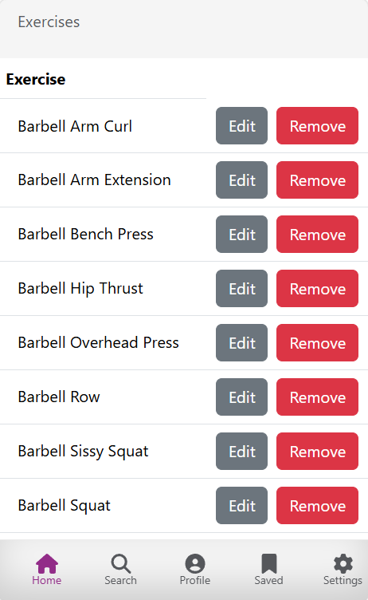
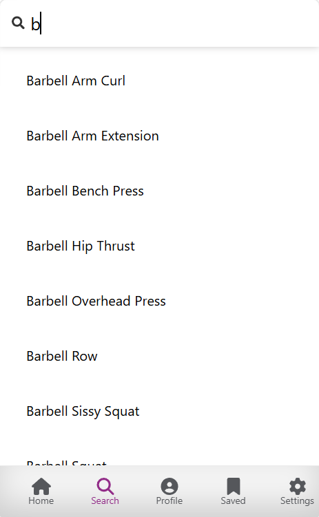
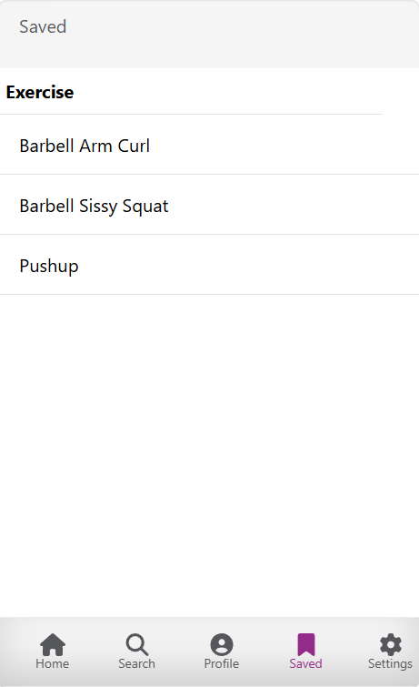

# Fitness App 

Unified project workspace containing the Fit2Go mobile web frontend and the Django REST backend. 

**Live app:** [https://fit2go-pro.netlify.app/](https://fit2go-pro.netlify.app/)

## Screenshots

> Add screenshots to a `screenshots/` folder in this repo, then update the paths below.





## Project Components

- `nutrition-nextjs/` -> frontend (Next.js mobile web app)
- `nutrition-backend/` -> backend (Django REST API)

## Exercise Images

The starter exercise images are stored in `nutrition-nextjs/public/images/exercises/` and served by the frontend at `/images/exercises/`. The seed records in `nutrition-backend/exercise.json` reference these local paths, so add or update the corresponding image file whenever you change a seed image path.

The images were sourced from [Free Exercise DB](https://github.com/yuhonas/free-exercise-db), which publishes its dataset under the [Unlicense](https://github.com/yuhonas/free-exercise-db/blob/main/LICENSE.md). The full downloaded source dataset in the root `exercises/` directory is local-only and is excluded from Git; only the images used by this app are included.

## Tools, Languages, and Frameworks

### Frontend

- **JavaScript (ES6+)** — the programming language the frontend is written in
- **Next.js 14** — React framework that provides file-based routing, server-side pre-rendering, and automatic code splitting per route
- **React 18** — the underlying UI library used by Next.js for component rendering and state management
- **Bootstrap and Reactstrap** — pre-built styling components for a consistent mobile-friendly layout
- **Google OAuth (`@react-oauth/google`)** — allows users to sign in with their Google account instead of creating a separate password
- **Node.js and npm** — required to run and build the Next.js app locally
- **Netlify** — hosts the frontend; the `@netlify/plugin-nextjs` plugin converts SSR pages and API routes into Netlify Functions automatically

### Backend

- **Python 3.11+** — the programming language the backend is written in
- **Django 4.2** — a Python web framework that handles routing, logic, and the database layer
- **Django REST Framework** — extends Django to build a JSON API that the frontend communicates with
- **JWT Authentication (`djangorestframework-simplejwt`)** — short-lived access tokens (15 min) and refresh tokens (7 days); refresh-token rotation and the blacklist app allow used refresh tokens to be revoked
- **django-cors-headers** — allows the frontend (on a different domain) to communicate with the backend
- **WhiteNoise** — serves static files efficiently in production without a separate file server
- **Gunicorn** — a production-grade web server that runs the Django app on Render
- **SQLite** — a lightweight database used during local development (no setup required)
- **PostgreSQL** — a more robust database used in production on Render
- **Render** — hosts and runs the backend API publicly

### General

- **Git and GitHub** — version control and remote code storage
- **VS Code** — code editor used during development

## Authentication

Fit2Go uses **Google OAuth** to authenticate users and **JWT (JSON Web Token)** access and refresh tokens to authorize API requests. The browser communicates directly with Django, avoiding Netlify function cold-start timeouts.

### Google sign-in and user creation

1. The frontend uses Google sign-in and sends Google's ID credential to `POST /api/auth/google/`.
2. The backend verifies the credential with Google's token-info API. It checks the configured Google client ID (audience), issuer, expiry, Google user ID, and verified email.
3. The backend identifies the user by Google's stable `sub` ID and uses Django's `get_or_create` to reuse an existing account or create one. Repeated sign-ins therefore do not create duplicate accounts. If an existing account's email does not match Google's verified email, sign-in is rejected with HTTP 409.
4. Django returns an access token, refresh token, and profile. The frontend saves the tokens in `localStorage` (`fit2go_access` and `fit2go_refresh`) and keeps the access token in React Context as `apiToken`.

### Access and refresh token lifecycle

- Access tokens expire after 15 minutes; refresh tokens expire after 7 days.
- Before an API request, the frontend checks the access token's expiry. If it is expired, the frontend sends the refresh token to `POST /api/auth/token/refresh/` before making the original request.
- If an API request still returns HTTP 401, the frontend attempts one refresh and retries the request once.
- The backend rotates refresh tokens: when a valid refresh token is used, it returns a new access token and refresh token and blacklists the old refresh token. The frontend saves both replacements. Concurrent requests share one in-flight refresh.
- If the refresh token is expired, invalid, or blacklisted, the frontend clears the session and the user must sign in again.
- On logout, the frontend clears `fit2go_access`, `fit2go_refresh`, and `fit2go_profile` from `localStorage`, then sends the refresh token to `POST /api/auth/logout/` for blacklisting.
- Authenticated API calls send the access token as `Authorization: Bearer <token>`. Logged-out public exercise browsing sends no authorization header.
- The profile (name, picture, and email) is stored in `localStorage` as `fit2go_profile` for UI display; it is not used as proof of identity.

Tokens are stored in browser `localStorage`, so JavaScript running on the page can access them. Keep dependencies up to date and protect the app against cross-site scripting (XSS).

### Authentication endpoints

| Method | Endpoint | Purpose |
| --- | --- | --- |
| `POST` | `/api/auth/google/` | Verify a Google credential, create or reuse the user, and issue tokens |
| `POST` | `/api/auth/token/refresh/` | Validate and rotate a refresh token |
| `POST` | `/api/auth/logout/` | Blacklist the submitted refresh token |
| `GET` | `/api/auth/hello/` | Example authenticated endpoint |

## Mobile App Notice

Fit2Go is a mobile app experience delivered through the browser.

When testing on desktop browsers, use the Inspect popup and switch to mobile mode:

1. Open the app in Chrome or Edge.
2. Right-click the page and select **Inspect** (a side panel opens).
3. In the Inspect panel, click the **phone/tablet icon** (Toggle device toolbar).
4. Pick a mobile device from the top dropdown (for example iPhone or Pixel).
5. Refresh the page and continue testing in mobile view.

## Key Features

- Browse and search a library of exercises by name
- Create, edit, and delete your own custom exercise records
- Bookmark exercises for quick access later
- Sign in with Google — no separate account or password needed
- User-specific data — your records are private and only visible to you
- Logged-out visitors see a default public exercise list; logged-in users see and manage only their own data
- Mobile-first design — built and optimised for use on a phone screen
- Data persists between sessions — your exercises and bookmarks are saved to a database

## Prerequisites

Install before setup:

- Git
- Node.js 18+ and npm
- Python 3.11+ and pip

Verify:

```bash
git --version
node -v
npm -v
python --version
pip --version
```

## Step-by-Step Setup

### 1. Open Workspace Root

```bash
cd "Fitness App"
```

### 2. Setup Backend

```bash
cd nutrition-backend
python -m venv .venv
.\.venv\Scripts\Activate.ps1
pip install -r requirements.txt
python manage.py migrate
python manage.py runserver
```

Backend runs at `http://localhost:8000`.

### 3. Setup Frontend

Open a new terminal:

```bash
cd nutrition-nextjs
npm install
```

Create `.env.local` with:

```env
NEXT_PUBLIC_BACKEND_URL=http://localhost:8000
NEXT_PUBLIC_CLIENT_ID=your-google-oauth-client-id
```

Create `nutrition-backend/.env` with local Django settings, including the same Google OAuth client ID:

```env
SECRET_KEY=your-local-development-secret
DEBUG=True
GOOGLE_CLIENT_ID=your-google-oauth-client-id
ALLOWED_HOSTS=localhost,127.0.0.1
CORS_ALLOWED_ORIGINS=http://localhost:3000,http://127.0.0.1:3000
```

Run frontend:

```bash
npm run dev
```

Frontend runs at `http://localhost:3000`.

### 4. Validate End-to-End

- Ensure backend terminal is running
- Open frontend in browser
- Switch to mobile viewport in inspect mode
- Confirm exercise list loads from API

---

## Deploying the App (Public)

The app has two parts that each need to be deployed separately: the **backend** on Render and the **frontend** on Netlify.

### Prerequisites

- Both `nutrition-nextjs/` and `nutrition-backend/` pushed to a GitHub repository
- A free [Render](https://render.com) account
- A free [Netlify](https://app.netlify.com) account

### 1. Deploy the Backend on Render

- Go to [render.com](https://render.com) and sign in
- Click **New** → **Web Service**
- Connect your GitHub account and select your repository
- Set the **Root Directory** to `nutrition-backend`
- Configure the service:
  - **Build command:** `./build.sh`
  - **Start command:** `gunicorn nutrition_app.wsgi:application`
  - **Environment:** Python
- Under **Environment Variables**, add:
  - `SECRET_KEY` — a long random string used by Django for security (also used to sign JWT tokens)
  - `DEBUG` — set to `False`
  - `ALLOWED_HOSTS` — your Render URL (e.g. `your-app.onrender.com`)
  - `CORS_ALLOWED_ORIGINS` — your deployed Netlify URL (e.g. `https://your-app.netlify.app`), used to restrict cross-origin API access to only your frontend
  - `GOOGLE_CLIENT_ID` — the Google OAuth client ID; set this to the same value as Netlify's `NEXT_PUBLIC_CLIENT_ID`
- The `./build.sh` build command runs `python3 manage.py migrate`, applying the SimpleJWT blacklist-table migrations required for refresh-token rotation and logout revocation. Check Render deploy logs for migration failures.
- Click **Create Web Service** and wait for the build to finish
- Copy your backend URL — you will need it in the next step

### 2. Deploy the Frontend on Netlify

- Go to [app.netlify.com](https://app.netlify.com)
- Click **Add new site** → **Import an existing project** → **GitHub**
- Select your repository
- Set the **Base directory** to `nutrition-nextjs`
- Configure the build:
  - **Build command:** `npm run build`
  - **Publish directory:** `.next`
- Under **Environment Variables**, add:
  - `NEXT_PUBLIC_BACKEND_URL` — your Render backend URL from step 1
  - `NEXT_PUBLIC_CLIENT_ID` — your Google OAuth client ID
- Click **Deploy site**

### 3. Open the Live App

- Your app will be live at your Netlify URL (e.g. `https://fit2go-pro.netlify.app`)
- Open it in a mobile browser, or use Chrome's mobile viewport in Inspect mode (see Mobile App Notice above)

---

## User Data and Privacy

Exercise items are user-specific. When a user signs in with Google, their created exercises and bookmarks are linked only to their account. One user's data is completely separate from another user's — no one can see or edit records that do not belong to them.

## Troubleshooting

- **Exercise list does not load**
  - Confirm the backend is running locally at `http://localhost:8000`, or check your Render deployment logs
  - Confirm `NEXT_PUBLIC_BACKEND_URL` is set correctly in `.env.local` (local) or in Netlify environment variables (deployed)

## Tools, Languages, and Frameworks

### Frontend

- **JavaScript (ES6+)** — the programming language the frontend is written in
- **Next.js 14 and React 18** — framework and UI library used to build the frontend
- **Bootstrap and Reactstrap** — pre-built styling components for a consistent mobile-friendly layout
- **Google OAuth (`@react-oauth/google`)** — allows users to sign in with their Google account instead of creating a separate password
- **Node.js and npm** — required to run and build the React app locally
- **Netlify** — hosts and serves the frontend publicly

### Backend

- **Python 3.11+** — the programming language the backend is written in
- **Django 4.2** — a Python web framework that handles routing, logic, and the database layer
- **Django REST Framework** — extends Django to build a JSON API that the frontend communicates with
- **JWT Authentication (`djangorestframework-simplejwt`)** — issues short-lived access tokens and rotating, revocable refresh tokens
- **django-cors-headers** — allows the frontend (on a different domain) to communicate with the backend
- **WhiteNoise** — serves static files efficiently in production without a separate file server
- **Gunicorn** — a production-grade web server that runs the Django app on Render
- **SQLite** — a lightweight database used during local development (no setup required)
- **PostgreSQL** — a more robust database used in production on Render
- **Render** — hosts and runs the backend API publicly

### General

- **Git and GitHub** — version control and remote code storage
- **VS Code** — code editor used during development

## Mobile App Notice

Fit2Go is a mobile app experience delivered through the browser.

When testing on desktop browsers, use the Inspect popup and switch to mobile mode:

1. Open the app in Chrome or Edge.
2. Right-click the page and select **Inspect** (a side panel opens).
3. In the Inspect panel, click the **phone/tablet icon** (Toggle device toolbar).
4. Pick a mobile device from the top dropdown (for example iPhone or Pixel).
5. Refresh the page and continue testing in mobile view.

## Key Features

- Browse and search a library of exercises by name
- Create, edit, and delete your own custom exercise records
- Bookmark exercises for quick access later
- Sign in with Google — no separate account or password needed
- User-specific data — your records are private and only visible to you
- Mobile-first design — built and optimised for use on a phone screen
- Data persists between sessions — your exercises and bookmarks are saved to a database

## Prerequisites

Install before setup:

- Git
- Node.js 18+ and npm
- Python 3.11+ and pip

Verify:

```bash
git --version
node -v
npm -v
python --version
pip --version
```

## Step-by-Step Setup

### 1. Open Workspace Root

```bash
cd "Fitness App"
```

### 2. Setup Backend

```bash
cd nutrition-backend
python -m venv .venv
.\.venv\Scripts\Activate.ps1
pip install -r requirements.txt
```

Create `nutrition-backend/.env` with the local settings shown in the first **Step-by-Step Setup** section, including `GOOGLE_CLIENT_ID`, then run:

```bash
python manage.py migrate
python manage.py runserver
```

Backend runs at `http://localhost:8000`.

### 3. Setup Frontend

Open a new terminal:

```bash
cd nutrition-nextjs
npm install
```

Create `.env.local` with:

```env
NEXT_PUBLIC_BACKEND_URL=http://localhost:8000
NEXT_PUBLIC_CLIENT_ID=your-google-oauth-client-id
```

Run frontend:

```bash
npm run dev
```

Frontend runs at `http://localhost:3000`.

### 4. Validate End-to-End

- Ensure backend terminal is running
- Open frontend in browser
- Switch to mobile viewport in inspect mode
- Confirm exercise list loads from API

---

## Deploying the App (Public)

The app has two parts that each need to be deployed separately: the **backend** on Render and the **frontend** on Netlify.

### Prerequisites

- Both `nutrition-nextjs/` and `nutrition-backend/` pushed to a GitHub repository
- A free [Render](https://render.com) account
- A free [Netlify](https://app.netlify.com) account

### 1. Deploy the Backend on Render

- Go to [render.com](https://render.com) and sign in
- Click **New** → **Web Service**
- Connect your GitHub account and select your repository
- If the repo contains both folders, set the **Root Directory** to `nutrition-backend`
- Configure the service:
  - **Build command:** `./build.sh`
  - **Start command:** `gunicorn nutrition_app.wsgi:application`
  - **Environment:** Python
- Under **Environment Variables**, add:
  - `SECRET_KEY` — a long random string used by Django for security
  - `DEBUG` — set to `False`
  - `ALLOWED_HOSTS` — your Render URL (e.g. `your-app.onrender.com`)
  - `GOOGLE_CLIENT_ID` — the Google OAuth client ID, matching Netlify's `NEXT_PUBLIC_CLIENT_ID`
- The `./build.sh` command runs `python3 manage.py migrate`, including the migrations for refresh-token blacklisting.
- Click **Create Web Service** and wait for the build to finish
- Copy your backend URL — you will need it in the next step

### 2. Deploy the Frontend on Netlify

- Go to [app.netlify.com](https://app.netlify.com)
- Click **Add new site** → **Import an existing project** → **GitHub**
- Select your repository
- If the repo contains both folders, set the **Base directory** to `nutrition-nextjs`
- Configure the build:
  - **Build command:** `npm run build`
  - **Publish directory:** `.next`
- Under **Environment Variables**, add:
  - `NEXT_PUBLIC_BACKEND_URL` — set to your Render backend URL from step 1
  - `NEXT_PUBLIC_CLIENT_ID` — your Google OAuth client ID, matching Render's `GOOGLE_CLIENT_ID`
- Click **Deploy site**

### 3. Open the Live App

- Your app will be live at your Netlify URL (e.g. `https://fit2go-pro.netlify.app`)
- Open it in a mobile browser, or use Chrome's mobile viewport in Inspect mode (see Mobile App Notice above)

---

## User Data and Privacy

Exercise items are user-specific. When a user signs in with Google, their created exercises and bookmarks are linked only to their account. One user's data is completely separate from another user's — no one can see or edit records that do not belong to them.

## Troubleshooting

- **Exercise list does not load**
  - Confirm the backend is running locally at `http://localhost:8000`, or check your Render deployment logs
  - Confirm `NEXT_PUBLIC_BACKEND_URL` is set correctly in `.env.local` (local) or in Netlify environment variables (deployed)
- **Google sign-in reports that it is not configured or fails verification**
  - Confirm Render's `GOOGLE_CLIENT_ID` matches Netlify's `NEXT_PUBLIC_CLIENT_ID`, then redeploy the backend after changing its environment variables
- **Refresh fails or the app asks you to sign in again**
  - A refresh token can only be used once after rotation. The app stores the replacement automatically; if the token expires or is blacklisted, sign in again.
- **Google login fails**
  - Ensure your Google OAuth credentials include the correct authorised redirect URIs for your environment
- **Backend migration errors on startup**
  - Run `python manage.py migrate` to apply any pending database migrations
- **`npm install` fails**
  - Confirm Node.js 18+ is installed: `node -v`
- **Port already in use**
  - Stop any existing process on port 8000 (backend) or 3000 (frontend) before starting again

## Project Structure

```text
Fitness-App/
  nutrition-nextjs/
    app/
    components/
    context/
    lib/
    package.json
  nutrition-backend/
    main_app/
    nutrition_app/
    manage.py
    requirements.txt
    build.sh
```

## Summary

Built a mobile-first fitness web application where users can browse, search, create, edit, delete, and bookmark exercise records. The Next.js frontend uses Google OAuth and JWTs for sign-in and API access, and is served through Netlify. The Django REST API verifies Google credentials, creates or reuses users, and issues short-lived access tokens with rotating, revocable refresh tokens. It uses SQLite locally and PostgreSQL in production on Render.
